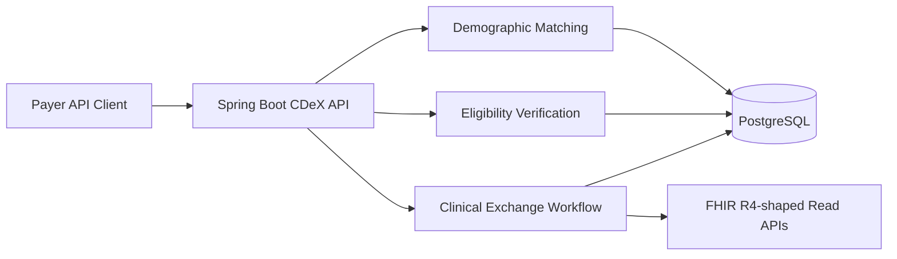

# WeCureIT CDeX Extension — Payer–Provider Data Exchange Demo

A **separate, educational Spring Boot backend** designed to extend the existing [WeCureIT clinic scheduling system](https://github.com/rohithyv/wecureit-clinic-reservation-system) with payer–provider workflows. Uses **synthetic** patient data only. It is not Oracle software and is not a production-ready healthcare system.

## Features implemented

- Spring Boot 3 / Java 17; relational persistence via Spring Data JPA (H2 local, PostgreSQL with Docker Compose)
- Active member coverage verification, including member-to-patient relationship check
- Deterministic patient demographic matching with `MATCHED`, `REVIEW`, `NO_MATCH` results
- Request lifecycle: coverage check → synthetic clinical document lookup → `COMPLETED` or `DATA_NOT_FOUND`
- Read-only FHIR **R4-shaped demo representations** for Patient, Coverage and Task (not a fully conformant FHIR server)
- Role-based demo HTTP Basic authentication (PAYER, PROVIDER), Spring Actuator health and metrics
- JUnit/Spring Boot integration tests; Docker Compose; GitHub Actions CI

## Architecture



## Quick start (Docker + PostgreSQL)

```bash
cp .env.example .env
# Edit .env and set unique development passwords

docker compose up --build
curl http://localhost:8080/actuator/health
```

Use your configured payer password:

```bash
curl -u payer:YOUR_PAYER_PASSWORD -H 'Content-Type: application/json' \
  -d '{"firstName":"John","lastName":"Carter","birthDate":"1988-04-21","postalCode":"22201"}' \
  http://localhost:8080/api/identity/match

curl -u payer:YOUR_PAYER_PASSWORD \
  http://localhost:8080/api/eligibility/MEM-100/PAT-100

curl -u payer:YOUR_PAYER_PASSWORD -H 'Content-Type: application/json' \
  -d '{"memberId":"MEM-100","patientId":"PAT-100","reason":"CLAIMS_SUPPORT"}' \
  http://localhost:8080/api/exchanges

curl -u payer:YOUR_PAYER_PASSWORD \
  http://localhost:8080/fhir/r4/Patient/PAT-100
```

To run tests locally with installed Java 17 + Maven:

```bash
mvn verify
```

## Endpoints

| Method | Endpoint | Purpose |
|---|---|---|
| POST | `/api/identity/match` | Patient demographic match |
| GET | `/api/eligibility/{memberId}/{patientId}` | Member coverage verification |
| POST | `/api/exchanges` | Create claim-support clinical-data request (payer only) |
| GET | `/api/exchanges/{id}` | Exchange request status |
| GET | `/api/records/{patientId}` | Synthetic clinical records |
| GET | `/fhir/r4/Patient/{id}` | FHIR R4-shaped patient representation |
| GET | `/fhir/r4/Coverage/{id}` | FHIR R4-shaped coverage representation |
| GET | `/fhir/r4/Task/{id}` | FHIR R4-shaped task representation |
| GET | `/actuator/health` | Basic health check |

## Limitations and engineering roadmap

This is a working **starter implementation**, not a certified healthcare integration.

1. Replace HTTP Basic with real OAuth2/OIDC authorization and scoped FHIR access.
2. Replace FHIR-shaped JSON maps with **HAPI FHIR R4 models, validation, profile conformance, and OperationOutcome** responses.
3. Add MPI/manual-review processes to prevent false positive patient links; match outputs do not auto-attach data.
4. Add an asynchronous Kafka ADT event pipeline with idempotency, replay, retry, and dead-letter queues.
5. Add proper clinical document access authorization, consent/purpose-of-use rules and complete non-PHI audit trails.
6. Add Flyway migrations, pagination, correlation IDs, tracing, Prometheus exports, Testcontainers and deployment hardening.
7. Integrate the APIs behind existing WeCureIT backend routes and connect React UI.

**Security warning:** demo authentication and sample configs are not production-grade. Use fictional records only; never add real patient data, real insurance details, API secrets, or credentials to GitHub.

## Ownership / provenance

This standalone extension was generated with AI assistance as a starting point. Review it, test it, customize it, and document which portions you personally implemented before making résumé claims. It does not copy the original WeCureIT source code.
